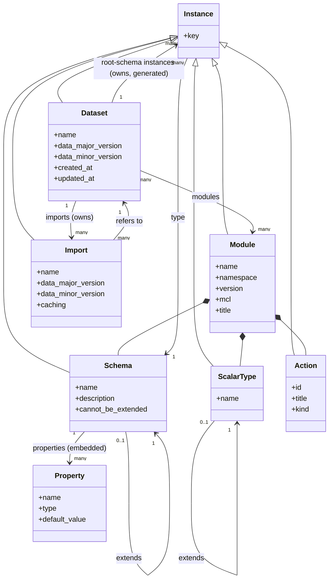

# The meta model

## Transient Objects

*Feature.*

Data manipulated with a model falls in three value categories:
- `scalar` or primitive (see [Scalar Types](#scalar-types)) , such as strings, numbers, booleans ...
- `object`:  an object is a dictionary of named properties with values
- `array`: an array is an ordered list of values

Here is an example in javascript like notation. 
It's an object with two properties: `product` a string, `suppliers` an array.
In `supliers` there are two similar objects each having a `name` string, and a `price`, another object with an `amount`, a number and a `currency` a string.
Note that the elements of an array do not have to be similar like in this example, an array can mix different categories of value.
```javascript
{
  product: "widgets",
  suppliers: [
    {
      name: "acme",
      price: {
        amount: 10.3,
        currency: "euro"
      }
    },
    {
      name: "coyote",
      price: {
        amount: 9,
        currency: "dollar"
      }
    }
  ]
}
```

Values can be transient, then they live in memory and are managed with a **programming language**. Javascript (or Typescript) is the target language but other languages can be supported. In the programming language transient values can be assigned to `variables`.

An object can be inside another object, as the value of a property or an item in an array property, it is then `embedded`, it is a full part of the containing object and not shared with other objects. 

In our examples the two supplier objects are embedded in the top object and the prices are embedded in the suppliers. Note that we call them suppliers because they are in the property `suppliers` and they look alike, but actually they are just two objects who happen to have same property names with same type of values.

A value can be serialized in JSON or YAML.

An example in [JSON](https://en.wikipedia.org/wiki/JSON) for the same object above.
for a `document` containing properties `title`, `author` and `document_parts`. The `document_parts` is itself an array of embedded objects with a `title` and a `content`.

```json
 {
  "product": "widgets",
  "suppliers": [
    {
      "name": "acme",
      "price": {
        "amount": 10.3,
        "currency": "euro"
      }
    },
    {
      "name": "coyote",
      "price": {
        "amount": 9,
        "currency": "dollar"
      }
    }
  ]
}
```

JSON is bit stricter than javascript as all property names must be quoted too.


The same object can be serialized the same way in [YAML](https://en.wikipedia.org/wiki/YAML), YAML is a superset of JSON.
YAML is more permissive than JSON or Javascript, only quotes are optional on properties and strings. 
When the JSON style is used it is called `flow` notation in YAML.
So the same example can be also serialized that way in YAML
YAML allows also comments starting with #, while JSON does not support comments
```yaml
{
  product: widgets
  # multiple suppliers ca provide this widget
  suppliers: [
    {
      name: acme,
      price: {
        amount: 10.3,
        currency: euro
      }
    },
    {
      name: coyote,
      price: {
        amount: 9,
        currency: dollar # non-euro currency allowed
      }
    }
  ]
}
```
YAML supports also the compact `block` notation where indentation is used for objects and - is used for arrays.
```yaml
product: widget
suppliers:
  - name: acme
    price:
      - amount: 10.3
        currency: euro
  - name: coyote
    price:
      - amount: 9
        currency: dollar
```

Flow notation can be used inside blocks, but not the contrary. So we could write also.
```yaml
product: widget
suppliers:
  - name: acme
    price: { amount: 10.3, currency: euro }
  - name: coyote
    price: { amount: 9, currency: dollar }
```

In the rest of this document we will use YAML unless stated otherwise.

## Instance

*Definition.*

An object can have a [Schema](#schema), a description of the properties and constraints on the the content of the object. 
Objects with a schema are called `instances`, they are instances of the schema, the schema can be called also the entity for the instance. 
The schema can be used as a "blueprint" to create, modify, validate and query the object.

Only instances can be used for property values and for array items in an instances, once there is a formal description of the structure of an object there has to be one for all its property values.

Instances can be **embedded** or **shared**, an embedded instance as a different copy in each instance using it, a shared instance is the same for all, if it is modified the change will be seen . 
(Note that in a programming language like javascript all objects or arrays are handled by reference, they must be copied to be embedded).

A property inside a shared instance whose value is another shared instance is called a `relation` (see [Relations](#relations)), relations can be seen as "links" between instances. Note that an embedded instance is not a relation (some would call it a composition relation, but we will avoid this language).

This is based on the principles of [entity-relationship](https://en.wikipedia.org/wiki/Entity%E2%80%93relationship_model) (ER) modeling.

## Schema

*Definition.*

A schema defines properties and constraints for instances. A schema is itself an entity, so there is a schema for all schemas (it is sometimes called the **meta-schema**), as it is a schema it's also its own schema.

The meta-schema is named "**schema**" and looks like this in YAML
```yaml
name: schema
description: the meta-schema for all schemas
shared_by_name:
has_description:
cannot_be_extended:
properties:
  - name: name
    type: identifier
    plural: identifier = ${name}s # default for multiple relations
    description: the name of this schema
  - name: description
    type: markdown
    description: the description of this schema
  - name: content
    type: markdown
    is_content:
    description: the content of this schema
  - name: extends
    type: schema
    inverse_name: extended_by
    inverse_is_array: true
    description: reuse all properties and constraints from this schema
  - name: cannot_be_extended
    type: boolean
    description: no schema can extend this one
  - name: properties
    type: "[property]"
    description: the properties for the instances of this schema
  - name: constraints
    type: "[constraint_value]"
```

Basically a schema has a `properties` attribute which lists the properties of the instances.
As this schema is its own schema (it's the only one doing that) it has a `properties` property definition in its own `properties`, an array of `property`.
The schema `property` is described in [Property](#property).

Constraints (see [Constraint](#constraints)) can be set directly on schemas and property definitions, alongside the declared properties, and are told apart by the same rule everywhere: a key not declared on the meta-schema is a constraint. Here are the schema constraints used above:
- `shared_by_name`: meaning instances of this schema (all schemas) are not embedded, and their name is used as a key (which means the name is unique in a dataset). This implies they have a property `name`, of type `identifier` unless the schema declares it with another string type, as [`module`](#module) does.
- `has_description`: meaning instances of this schema have a non empty `description` property of type `markdown`, descriptions are useful for humans and AI assistants.

Constraints on a schema look like properties, but actually they are not defined in the `schema` meta-schema — that's how they are identified. Constraints on a property definition look also like properties, but they are not defined in the `property` meta-schema.

The properties in a schema are:
- `name`: an `identifier`, not empty, this is coming from the `shared_by_name` constraint of the meta-schema (itself).
- `description`: a `string`, not empty, this is coming from the `has_description` constraint of the meta-schema.
- `content`: a `markdown` text, the schema's own content, empty by default. It carries the `is_content` role (see [Property Constraints](#property-constraints)), so a persistent format holding an instance's primary content apart from its fields keeps it there — for the `obsidian` format, the body of the schema's note. A property whose `default_value` is `${this.schema.content}` (see [Placeholders](#placeholders)) gives every new instance of the schema that content as its starting value. `extends` reuses property definitions rather than values, so each schema holds its own `content`: a schema extending another starts its instances from its own content, and a template belongs to every schema that gets instantiated.
- `extends`: a reference to a `schema`; `inverse_is_array: true` says the inverse of this relation (schemas extending this one) is an array.
- `cannot_be_extended`: meaning this schema cannot be extended.
- `properties`: an array of `property`, can be empty. The notation `[property]` means an array of `property`.
- `constraints`: an array of constraint values, set directly with `name: value` entries.

`extends` simply means that the schema reuses all properties and constraints from another schema (try to avoid loops, they will be detected and reported to the meta-police).
We notice that `extends` is not defined on `schema`, meaning the meta-schema extends no other schema.

A [Command](model-command-language.md#command)'s `schema` matches instances of that schema and, transitively, instances of every descendant of that schema: every schema extending it, directly or through another descendant. Querying, updating or deleting against a base schema therefore also reaches the instances of its descendants.

`inverse_name: extended_by` names the "virtual" inverse relation (see [Relations](#relations)). This will match or create an `extended_by` property on the target schema listing all schemas extending it directly. We do not see this property on `schema` so it is added implicitly.

`cannot_be_extended:` means this meta-schema cannot be extended (why would you do that?, it's already perfect!)

`properties` can be an array without breaking a rule as the schema `property` is embedded.

## Property

*Definition.*

A schema defines a list of properties for the instances. Each definition is an instance of the `property` schema.
Outside the transient format a property is always embedded, usually in the `properties` of a schema.

The meta-schema for property looks like this
```yaml
name: property
embedded:
description: the meta-schema for property definitions in a schema
properties:
  - name: name
    type: identifier
  - name: type
    type: type_name
  - name: default_value
    type: string
    description: value to use when the property is not set
  - name: null_value
    type: string
    description: value to use when the property is set to null
  - name: constraints
    type: "[constraint_value]"
has_description:
```

A property definition is always written as a plain object with explicit `name`, `type`, and (optionally) `default_value` keys, e.g. `{name: age, type: integer, default_value: 0}`. There is no one-line shorthand collapsing them into a single key — that convention was tied to the now-retired stereotype markers and was dropped along with them, in favor of one uniform authoring rule everywhere: a plain object, declared keys read literally, anything else a constraint (see [Schema Processing](model-command-language.md#schema-processing)).

A property description is `embedded`, this means they are not shared between schemas.

The `default_value` of a property, a relation, a map or an array is used when the property is not given at entity construction, this is not mandatory, if it is not given the default value will be the `type` default value (see [Scalar Types](#scalar-types)).

The default value is a `string` that must eventually convert to a valid value compatible with the `type`, for example if `type` is `number` the string must represent a valid number. The default of an array or a map can also be written as the list or the mapping itself, such as `default_value: [physical]`, and the default of a relation is a key. 

The `default_value` may contain [Placeholders](#placeholders) of the form `${value}`. A value that is exactly one placeholder keeps its type, so a key stays a key and a map stays a map. An explicit `null` in the input means none, and the default does not apply. A default applies once, at creation, and is copied.

A very important feature on properties is that the value of a property which is not a relation (the type is not a shared schema) cannot be **null**. Null is only used for empty relations (which is possible only if the relation is not mandatory). The one exception is a property of a [facet](#facet), whose unset value is stored by omission.

An embedded property can define a `null_value` 

This mean the construct `property_name:` without a value in YAML will lead to the use of the null value (from YAML spec this is parsed as a null value)

If the `null_value` is not given the `default_value` of the type is used, one place they are different is for the `boolean` type, the default value is `false`, when a boolean property is not present it is false, but the null value is `true`, when the property is set in YAML without a value it becomes true. (see `cannot_be_extended` in [Schema](#schema) for an example)

Note also that if a property is an array the default (an null) value of the property is `[]`, an empty array. But if null values are inserted they will take the null value defaut.

**Map types.** A property typed `{K: V}` holds a map: unordered entries, each key of type `K` unique, each value of type `V`. `K` is a string-based scalar type and `V` a scalar type; a relation, an array or another map is not supported. The notation is written as a quoted string, like `"[property]"`, so YAML does not read it as a mapping. The default and the null value is `{}` unless a `default_value` gives a mapping, or a placeholder that resolves to one; there is no `null_value`, and `is_array` is a `constraint_violation` on a map. `localized_string` and `localized_markdown` are built-in names for two such types (see [Internationalization](#internationalization)). A persistent format that does not interpret a map stores it as an ordinary object.

**Reserved property names.** A few property names carry a meaning beyond the schema declaring them. `name` and `id` are the key of a shared schema, per [Keys](#keys). `display_name` holds the human-readable label of an instance: a schema declaring it states that this property carries the label, and a reader of the model — a [persistent format](#persistent-formats) among them — uses it wherever a label is called for rather than the key. The property may be a `string` or a `localized_string` (see [Internationalization](#internationalization)); a reader showing a localized value uses the entry of the language it shows. No constraint marks any of these names, the name itself is the convention.

## Placeholders

*Definition.*

Placeholders are similar to [ javascript template literals](https://developer.mozilla.org/en-US/docs/Web/JavaScript/Reference/Template_literals),  but the language is more restricted. 
A place holder in a `string` (usually a default value for a property or a constraint) has the form `${content}`, at entity construction the content will be replaced.

The content is either:
- a list of dot separated identifiers to access properties of objects. The first one can be:
	- `this`: for the instance or property under construction, or the instance a [rule](#rules) or a [filter](model-command-language.md#filter) evaluates
	- `this.schema`: for the schema of the instance or property
	- `this.instance`: for the instance if this is a property
	- `this.instance.schema`: for the schema of the instance
	- `dataset`: for the dataset owning the instance if there is one
- a predefined function see the list below

When a path segment reaches an array (e.g. a `command_result`'s `after`), the next identifier is one of three things:
- an index (`0`, `1`, ...) selecting one entry
- `*`, mapping the *rest* of the path over every entry and returning the results as an array — `after.*.id` is every entry's `id`, as an array (`[after.0.id, after.1.id, ...]`). `*` can be chained across nested arrays, one map per `*` (`rows.*.*.cell` maps over each row, then over each cell within it). Unlike the default below, `*` on an empty array resolves to `[]` rather than an error — there's no single "the one entry" it's short for, so there's nothing missing.
- otherwise (the identifier isn't an index or `*`) — resolved against entry `0` directly, so `after.name` means the same thing as `after.0.name`

A path that ends exactly at the array, with no further identifier, still resolves to the array itself. The entry-`0` default lets a placeholder skip the index entirely for the common case of "the one entry a command produced," while still allowing an explicit index to reach any other entry; `*` is for the less common case of actually wanting every entry, as an array, rather than just the first.

**Across relations.** A path crosses single-valued relations, with the same reach as a [filter](model-command-language.md#filter) path: `${this.type.default_scope}` reads `default_scope` on the instance `type` points at. A path that meets a null relation gives the ordinary default of the property, not an error. The engine reads the related instances before it constructs the instance.

The creation of an instance always follow the steps:

1. Create the instance with the property value given as parameters and the default value for the other properties from the schema.
2. Add the properties defined by constraints when they do not exist, create an error for those with no default value that do not exist.
3. Resolve all placeholders.

The placeholders are replaced in the order of appearance in the schema, if placeholders relies on other placeholders being resolved first they should be set placed the right order.

The functions that can be used in a placeholders are

| `function_name`        | `definition`                                                  | `example`                                 | example result             |
| ---------------------- | ------------------------------------------------------------- | ----------------------------------------- | -------------------------- |
| to_display_name        | Create a name with white spaces and capitals                  | to_display_name("properties_constraint")  | "Properties Constraints"   |
| now()                  | Current time. Returns a datetime than converts to a UTC time. | now()                                     | "2026-08-07T19:36:18.191Z" |
| year(), month(), day() | Extract from a date                                           | year(now())<br>month(now())<br>day(now()) | "2026"                     |
|                        |                                                               |                                           |                            |

## Internationalization

*Concept.*

A property that holds text for people, in CORE typically `display_name` and `description` (see [Property](#property)), can hold it in several languages. A schema opts in by giving the property one of two built-in types; every other property stays a plain `string` or `markdown`, and a dataset that never uses them is unaffected.

| type | is the map type |
| --- | --- |
| `localized_string` | `{language_code: string}` |
| `localized_markdown` | `{language_code: markdown}` |

`language_code` is a built-in scalar type (see [Scalar Types](#scalar-types)). The two types are map types (see Property, "Map types"), provided by the engine.

```yaml
properties:
  - name: display_name
    type: localized_string
    min_length: 1

display_name: { en: Plant, fr: Usine }
```

The dataset holds every language; CORE has no notion of a current language. A reader, typically an application, chooses the language to show and its fallback, and the other entries stay available to compare and to translate directly. Translating is an ordinary update of an instance by a user, not a configuration of the application and not a bulk operation on the dataset: `{update: actor_type, filters: {name: plant}, input: {display_name: {set: {fr: Usine}}}}` sets one language and leaves the others as they are (see [Command](model-command-language.md#command), "Map operations"). A language is filtered like any entry of a map (see [Filter](model-command-language.md#filter)).

Not covered yet: which entry is the source language, and detecting a translation that a change of the source made stale.

## Constraints

*Definition.*

A constraint is set on a schema, a property, or a [scalar type](#scalar-types), it defines integrity rules on the instances and their properties, those rules are used when entities are created with the command language (see [Modelling Language](why-modelling.md#modelling-language)). They can be used also to validate entities in case they have been built bypassing the language or the language could not enforce at creation.

Constraint are pre-defined in the meta- model and their interpretation is implemented by the command language.
There is currently no mechanism to express new constraints and to define formally their interpretation.

Note that the term "constraint" will be used depending on context for both the constraint definition and the constraint application in a schema, property, or scalar type.

A constraint definition follows the following schema, note that this schema is for documentation as constraints are built in, not interpreted from a formal description.
```yaml
name: constraint
properties:
  - name: identifier
  - type: type
  - description: markdown
  - default_value: string
```

Like a property a constraint has attributes `name` and `type` (which is a type name). It is also possible to write a constraint definition as:
constraint_name: type_name`
This will translate to
`name: constraint_name [= constraint_default_value]`
`type: type_name`
`default_value = constraint_default_value`

A constraint is never mandatory on a schema or a property. The `default_value` is used when the constraint is not present. If `default_value` is not defined the type default value is used.
Like for properties, constraint values cannot be null, and the same mechanism applies for null values. A boolean constraint can be triggered in YAML just by stating the name without value.

A constraint application is the use of a constraint in a schema, a property, or a scalar type.
It's an embedded instance defined from the following schema
```yaml
name: constraint_application
properties:
  - name: identifier
  - value: string
```

The name is the constraint to apply, and the value is given to the constraint.
As with properties, a constraint application can be written as:
`constraint_name: constraint_value`

 Any `key: value` in a schema, a property definition, or a scalar type which is not defined on the corresponding meta-schema (`schema`, `property`, or `scalar_type`) is interpreted as a constraint application. This is the only authoring convention left — no markers, nothing to declare to enable it.

Constraints valid for schemas are defined in [Schema Constraints](#schema-constraints)

Constraints valid for properties are defined in [Property Constraints](#property-constraints)

Constraints specific to primitive (scalar) types, and the `scalar_type` meta-entity itself, are defined in [Scalar Types](#scalar-types)

Constraints specific to relations are defined in [Relations](#relations)

## Schema Constraints

*Definition.*

Schema constraints are used in a schema, they express constraints on the entities using the schema.

The pre-built schema constraints are the following, default type is boolean.

| `name`           | `description`                                                                                                                                                           |
| ---------------- | ----------------------------------------------------------------------------------------------------------------------------------------------------------------------- |
| `embedded`       | the instances are is embedded, by default the instances of  a schema are shared (not embedded).                                                                         |
| `shared_by_name` | the schema is not embedded and the `name` is used as key. <br>This constraint is incompatible with `embedded`.                                                          |
| `singleton`      | the schema has at most one instance in the dataset; a `create` of a second instance fails with `constraint_violation`. This constraint is incompatible with `embedded`.                                                                       |
| `is_root`        | The schema instances are not owned, the schema must be shared. See [Ownership](#ownership). <br>This constraint is incompatible with `embedded`. |
| `constant`       | The schema instances are immutable after creation. All properties are constant.                                                                                         |
| `abstract`       | the schema has no instance of its own: a `create` against it is a `constraint_violation`, and only its descendants have instances. |
| `crud: crud_declaration` | the actions that create, update and delete the instances, see [Action](#action). |
| `checks: [check]` | named conditions on each instance, see [Rules](#rules). |
| `unique: [unique_group]` | named groups of properties whose values no two instances share, see [Rules](#rules). |
| `facet_of: schema` | the schema is a [facet](#facet) of the named schema. <br>This constraint is incompatible with `embedded`, `is_root` and `shared_by_name`. |
| `observable`     | The instances are tracked by the model's observability mechanism — a create, update, or delete is included in the notification delivered when a transaction commits or a dataset is reset. See `@scfloworg/core`'s `docs/observability.md`. <br>This constraint is incompatible with `embedded`. |
| `ui_access: string` | how a user interface may expose the instances and their properties: `hidden`, `read_only` or `editable`, default `read_only`. It is the default level of the schema's properties, see "UI access" in [Property Constraints](#property-constraints). Advisory for user interfaces: command processing ignores it. Any other value is rejected by schema processing as a `constraint_violation`. Inherited through `extends` and refined by the extending schema. |

## Property Constraints

*Definition.*

Properties constraints are used in a [Property](#property) definition of a schema, they express constraints on the property in instances using the schema.

The pre-built property constraints are the following, note that property constraints do not emit other properties. Otherwise specified the type is `boolean`.
Most property constrains are described with:
- [Scalar Types](#scalar-types)
- [Relations](#relations)

| `name`                | `description`                                                                                                                                                                                                                                                                                                             |
| --------------------- | ------------------------------------------------------------------------------------------------------------------------------------------------------------------------------------------------------------------------------------------------------------------------------------------------------------------------- |
| `is_array`            | the property is an array. This constraint can also be set in the type using `[]`. Only valid on a property whose type resolves to a [scalar type](#scalar-types) — a relation is always single-valued when declared directly (see [Relations](#relations)); setting `is_array` on a relation property is a `constraint_violation`, and so is setting it on a map type (see [Property](#property), "Map types").                                                                                                                                                                                                                                          |
| `is_set`              | the property is a set: an array of distinct values of an enum scalar type, whose order carries no meaning. Implies `is_array`. Only valid on a scalar property whose constraints include `enum`, from its scalar type or from the property itself — setting it on a relation, a map or a property without `enum` is a `constraint_violation`. See "Sets" below. |
| `is_unique`           | the property is an array of distinct entries, kept in the order given. Implies `is_array`. Only valid on a scalar property of any type, with no `enum` required — setting it on a relation or a map is a `constraint_violation`. See "Unique arrays" below. |
| `min_length: integer` | minimum length if the property is an array, or minimum number of entries if it is a map                                                                                                                                                                                                                                                                                |
| `max_length: integer` | maximum length if the property is an array, or maximum number of entries if it is a map                                                                                                                                                                                                                                                                                |
| `updated_by: string`  | the id of the action that updates this property, which the generated update leaves out. See [Action](#action). |
| `set_once`            | a relation or a scalar set at most once: from no value to a value, by `create` or `update`. No value is a null relation, or a scalar equal to the default of its base type (`""`, `0`, `false`). Setting the same value again changes nothing, and any other change, or clearing it, is a `constraint_violation`. Not valid with `constant`, on an array or on a map. |
| `acyclic`             | valid only on a single-valued relation whose target is its own schema or an ancestor of it: following the relation from an instance never leads back to that instance. See [Rules](#rules). |
| `constant`            | the value is fixed at creation — from an explicit `input` value, a `default_value` (including one resolved from a [Placeholder](#placeholders)), or left unset if there is none. Any later `update` touching it is a `constraint_violation`. Applies to relations as well as scalar properties. |
| `is_content`           | at most one per schema; the property's type must resolve to [`markdown`](#scalar-types). Marks the property a [persistent format](#persistent-formats) may treat as an instance's primary content instead of a discrete field — e.g. a note's body rather than its frontmatter. A format that doesn't interpret it stores the property as ordinary data. See the `getInstance` doc comment of `PersistenceInterface` in `@scfloworg/core`. |
| `is_folder`            | at most one per schema; the property's type must resolve to a string-based scalar type. The property's value is a `/`-separated relative path a persistent format may use to place the instance. A format that doesn't interpret it stores the property as ordinary data. See the `getInstance` doc comment of `PersistenceInterface` in `@scfloworg/core`. |
| `observable`           | valid only on a relation property, and only when the declaring schema itself carries the [`observable`](#schema-constraints) schema constraint — `constraint_violation` otherwise (a non-relation property, or a declaring schema without `observable`). Marks that a change to the relation's *target* instance is also reported as a `delta` entry for the declaring instance itself (`via` set to this property's name), even though the declaring instance's own storage wasn't touched. The target schema does not need `observable` itself for this to fire. See `@scfloworg/core`'s `docs/observability.md` ("Related changes"). |
| `ui_access: string`    | how a user interface may expose the property: `hidden`, `read_only` or `editable`. No default: when absent, the property takes the level of its schema. A property restricts its schema's level and never exceeds it. Any other value is rejected by schema processing as a `constraint_violation`. See "UI access" below. |

**Sets.** `is_set` implies `is_array`: the processed property carries both, so `min_length` and `max_length` apply and count entries. A `create` or `update` whose value holds the same entry twice is a `constraint_violation`; a value holding an entry outside the `enum` is one too. The stored value lists its entries in the declaration order of the `enum`, whatever the order of the input, so two equal sets are stored identically. A value stored before `is_set` was set keeps its stored order until the instance is next written. A filter compares a set without regard to order (see Filter, *Sets*).

**Unique arrays.** `is_unique` implies `is_array`: the processed property carries both, so `min_length` and `max_length` apply and count entries. A `create` or `update` whose value holds the same entry twice is a `constraint_violation`. Unlike a set, the entries keep the order given and no `enum` is required. Entries are compared as written, so `North` and `north` are two entries. A property that is both `is_set` and `is_unique` behaves as a set. A filter compares a unique array in order, like any array. Setting `is_unique` on a property whose stored values hold a duplicate is an incompatible model change for those instances (see [Model Upgrade](#model-upgrade)).

The key of a shared instance (see [Keys](#keys)) is a property with `constant` implicitly set — changing it is rejected the same way as any other constant property, with no special-casing needed in [Command](model-command-language.md#command) processing.

**Property roles.** `is_content` and `is_folder` don't change what's valid data — they mark which property plays a given role, for whichever persistent format cares to act on it. At most one property per schema may carry each; together they form the schema's `propertyRoles` (`Record<role, propertyName>`), computed once by [Schema Processing](model-command-language.md#schema-processing) and handed to the `getInstance`/`listInstances`/`putInstance` of a [Persistence Interface](typescript-reference-implementation.md#persistence-interface) — see the doc comment of `getInstance` in `@scfloworg/core` for how an implementation may use it.

**UI access.** `ui_access` is a hint to user interfaces: command processing, scripts and tool access ignore it. The levels are ordered `hidden` < `read_only` < `editable`: a `hidden` entity is not shown, a `read_only` one is shown, an `editable` one is shown and its value may be changed by a user. A schema without `ui_access` is `read_only`, so nothing is editable unless a schema says so.

The effective level of a property is the lowest of: the level of its schema; its own `ui_access`, the schema's level when absent; and `read_only` when the property cannot be updated, that is a `constant` property (including the key of a shared instance and every property of a `constant` schema) and a property generated by another schema's `inverse_name`. A `hidden` schema hides all its properties. `ui_access` does not cover creating or deleting instances from a user interface.

The pure function `uiAccessOf(schema, propertyName?)` of `@scfloworg/core` (see its doc comment) computes the effective level of a schema, or of one of its properties.

## Scalar Types

*Feature.*

The following basic scalar types are available for properties. They match the YAML types.

| type      | description                                                                                                  | default value                          | examples in YAML                      |
| --------- | ------------------------------------------------------------------------------------------------------------ | --------------------------------------- | ------------------------------------- |
| `string`  | textual data                                                                                                 | ""                                     | John Doe<br>"Hello, World\n"          |
| `number`  | floating point numerical value                                                                               | 0                                       | 3.14159<br>-1.2e+3                    |
| `integer` | whole numbers                                                                                                | 0                                       | 30<br>0x1A (hex, unavailable in JSON) |
| `boolean` | logical true or false                                                                                        | `false`<br>but null value is<br>`true` | `true`<br>`false`                     |
| `null`    | empty or undefined value, only for relations, otherwise replaced by default value (or null value if defined) | `null`                                  | `null`, `~` or blank                  |

For each type, constraints can be set on the properties using them. The constraints can also be bundled into a **scalar type**: a named refinement of a base type (or of another scalar type) that can then be used as a valid `type` for a property, the same way `string` or `integer` can.

```yaml
name: scalar_type
shared_by_name:
constant:
description: a named refinement of a base scalar type, built from constraints
properties:
  - name: name
    type: identifier
  - name: extends
    type: scalar_type
    description: the base scalar type (string, number, integer, boolean) or another scalar_type this one refines
  - name: constraints
    type: "[constraint_value]"
```

The `constant` [schema constraint](#schema-constraints) makes scalar type instances immutable after creation: a scalar type can only be created, never updated or deleted — attempting either raises the usual `constraint_violation` (see [Command](model-command-language.md#command) processing).

Note that a boolean constraint automatically defines a scalar type with the same name and the true value.

**constraints for string, number and integer**

| constraint     | description                   |
| -------------- | ------------------------------ |
| `enum: [type]` | the value must be in the list |

It is possible to create new enum scalar types as in the following example

```yaml
name: card_color
extends: string
enum: [spade, heart, diamond, club]
```

**string constraints**

| constraint            | description                             |
| --------------------- | ---------------------------------------- |
| `min_length: integer` | minimum length of the string            |
| `max_length: integer` | maximum length of the string            |
| `pattern: regexp`     | the string must match the regexp        |
| `regexp: boolean`     | the string must be a valid regexp       |
| `markdown: boolean`   | the string contains markdown formatting |

The following scalar types are the standard types of [`mcl:core`](#the-core-module), defining new string types:

```yaml
name: date
extends: string
pattern: '^\d{4}-\d{2}-\d{2}$'

# a precise UTC instant, not a local/civil time — no timezone offset, always Z
name: date_time
extends: string
pattern: '^\d{4}-\d{2}-\d{2}T\d{2}:\d{2}:\d{2}(\.\d+)?Z$'

name: time
extends: string
pattern: '^\d{2}:\d{2}:\d{2}(\.\d+)?$'

name: identifier
extends: string
pattern: '^[A-Za-z_][A-Za-z0-9_]*$'

name: email
extends: string
pattern: '^[^\s@]+@[^\s@]+\.[^\s@]+$'

name: uuid
extends: string
pattern: '^[0-9a-f]{8}-[0-9a-f]{4}-[0-9a-f]{4}-[0-9a-f]{4}-[0-9a-f]{12}$'

# ISO 8601 duration: PnYnMnDTnHnMnS, e.g. P1DT2H30M, PT30M
# Y/M/D are calendar components (length varies once anchored to a date), H/M/S are exact time components
name: duration
extends: string
pattern: '^P(?=.)((\d+Y)|(\d+M)|(\d+W)|(\d+D))*(T(?=.)((\d+H)|(\d+M)|(\d+(\.\d+)?S))*)?$'

# a language, optionally with a region (en, fr, pt-BR); the key type of localized_string and localized_markdown
name: language_code
extends: string
pattern: '^[a-z]{2}(-[A-Z]{2})?$'

# publisher:module, the key of a module
name: module_key
extends: string
pattern: '^[a-z][a-z0-9_-]*:[a-z][a-z0-9_-]*$'

name: semantic_version
extends: string
pattern: '^\d+\.\d+\.\d+$'

# an exact version, or a range such as ^1.3
name: version_range
extends: string
pattern: '^[\^~]?\d+(\.\d+){0,2}$'
```

**number and integer constraints**

| constraint                  | description                     |
| ---------------------------- | -------------------------------- |
| `minimum: number`           | minimum value                   |
| `maximum: number`           | maximum value                   |
| `exclusive_minimum: number` | minimum value excluding  bound  |
| `exclusive_maximum: number` | maximum value excluding bound   |
| `multiple_of: number`       | must be a multiple of the value |

## Relations

*Definition.*

Relations are properties from a shared instance having as type the schema of a shared instance.

A shared instance is an instance of a schema having the `shared` or the `shared_by_name` constraint.
Relations are the only properties allowed to be `null`, the null value means there is no entity on the other side of the relation.
`null` is also the default value of a relation when it is not given at instance creation.

A directly declared relation is always single-valued: `is_array` cannot be set on a relation property — see [Property Constraints](#property-constraints). A relation reaching several instances only exists as a **virtual** relation, generated on the target schema from `inverse_is_array` (see below). In consequence a many-to-many relationship cannot be declared directly: it must be reified as its own schema, holding a direct relation to each side.

The following constraints are applicable on relations.

| `constraint`                    | `description`                                                 |
| ------------------------------- | ------------------------------------------------------------- |
| `mandatory`                     | The property cannot be null; deleting its target is refused unless `on_delete` says otherwise |
| `inverse_name: string`          | The name of the inverse relation on the target schema         |
| `inverse_is_array: boolean`     | The inverse relation is multiple — the only way a schema exposes several related instances |
| `inverse_is_mandatory: boolean` | The inverse relation is mandatory (it should not be an array) |
| `on_delete: string`             | what a deletion of the target does to the declaring instance: `restrict`, `cascade` or `set_null`, see [On Delete](#on-delete) |
| `owns: boolean`                 | see [Ownership](#ownership)            |
| `owner: boolean`                | see [Ownership](#ownership)            |

A relation must be declared on one side only, the declaration of an inverse relation is not mandatory, when it is done it creates a "virtual" relation on the target schema. 

If an inverse relation is declared it is an error if a relation with the same name is found in the target schema.

When a relation property is given a value, that value must be the key of an instance of the relation's declared schema, or of a schema extending it (see [Schema](#schema)'s `extends`) — `unknown_relation_target` is thrown otherwise, whether the key doesn't resolve to any instance at all or resolves to an instance of an unrelated schema.

The virtual relation can be used in the modelling language as a regular relation, for both reading and writing, and changes will be reflected on the original relation. A value given to it at instance creation reaches the declaring side the same way one given by a later update does: the declaring instance's own relation gains the new instance's key, and everything that follows from it — the declaring side's own validation and its ownership — applies from that moment.

Unlike a declared relation, a virtual relation is never stored: a persistent format never sees it, in `putInstance`'s `instance` argument or anywhere else. The generic layer computes its value on demand — a join over the declaring schema's instances, matching on the declaring property — every time a virtual relation is read, whether as a returned property or as the left-hand side of a filter (`owning_document == this` in a query works the same way whether `owning_document` is declared or generated). This join runs entirely above [Persistence Interface](typescript-reference-implementation.md#persistence-interface): a format implementation is unaware virtual relations exist. A future revision may let a format perform the join itself once negotiated with that format's own query capabilities; until then every format pays the same in-memory join cost. One consequence: cascade-deletion and any other logic that walks ownership by scanning a candidate's stored `owner` property must instead walk from the `owns` side's own declared relation when that `owner` property is generated — there is nothing left to scan on the owned side's own storage.

For example with the following schemas, adding an `edge` to the `outgoing_edges` of a node will automatically assign this node as the `predecessor` of the edge and remove it from it's previous predecessor node outgoing edges.
Removing an edge from the outgoing or ingoing edges of a node will raise an error as the relations on edge are mandatory and that would let the edge with a null relation.

```yaml
name: node
properties:
  - name: name
    type: string

name: edge
properties:
  - name: predecessor
    type: node
    mandatory:
    inverse_name: outgoing_edges
    inverse_is_array:
  - name: successor
    type: node
    mandatory:
    inverse_name: ingoing_edges
    inverse_is_array:
```

## Facet

*Feature.*

A facet is a schema that adds properties to the instances of another schema, its **target**, of the same module or of a dependency. It is the only way for a module to add a property to a schema of another module: the owner of the target stays unchanged, and an instance of the target stays whole when the module goes away.

```yaml
# Module acme:carbon, namespace carbon, depends on scflow:core
name: actor_emissions
facet_of: scflow.actor
properties:
  - name: co2
    type: number
```

- **Stored apart.** The values sit in an instance of the facet, with the key of the target instance. A facet has no `name` property and no key of its own. The target and its descendants (see [Schema](#schema)'s `extends`) show the properties of the facet in every [Command](model-command-language.md#command), and in the schema as a client reads it.
- **Qualified properties.** A property of a facet carries the namespace of the module of the facet: a path names `carbon.co2`, and a result holds `{id, display_name, carbon: {co2: 12}}`. Two modules can each define `capacity`. A property of the target or of a descendant named like a namespace in use is refused.
- **Several facets of one module on one target** share the namespace, and a name clash between them is refused.
- **Optional values.** A property of a facet needs no default, and an unset value is stored by omission. This is the one exception to the rule that a scalar is never null, because a capacity of `0` and an unknown capacity are different facts. An unset value satisfies no predicate, `ne` included, like a missing entry of a map, and only `exists` tests it (see [Filter](model-command-language.md#filter)).
- **Created on first value.** Using a module in a dataset writes nothing. The instance of a facet is created when one of its values is first set. A `default_value` is read when no value is stored.
- **Applies to every instance of the target.** A facet has no condition. A property that makes no sense on some instances stays unset.
- **Reached only through its target.** A command whose `schema` is a facet is refused with `facet_not_addressable`, and no relation targets a facet.
- **One instance per target.** Several values per target are an owned schema, whose inverse relation is qualified too, such as `carbon.emissions` (see [Virtual relations](model-command-language.md#schema-processing)).
- **Assembled per dataset.** The schema of a module holds no facet of another module. The engine adds the facets of the modules a dataset uses, so a dataset without the module sees the target bare.
- **Deleted with its target.** Deleting an instance of the target removes its facet instances, whatever their module.

A breach of these rules is a `constraint_violation` raised by [Schema Processing](model-command-language.md#schema-processing).

## On Delete

*Feature.*

`on_delete` is a [relation](#relations) constraint stating what becomes of an instance when the instance its relation points at is deleted. Its value is one of:

| Value | Effect when the target is deleted |
| --- | --- |
| `restrict` | The delete is refused with a `constraint_violation` and nothing is removed. |
| `cascade` | The instance is deleted too, and reported in `cascade-deleted`. |
| `set_null` | The relation is cleared. |
| `confirm` | A plain delete is refused with a `constraint_violation`, and a delete with `cascade: true` removes the instance, as `cascade` does. |

Without `on_delete`, a `mandatory` relation is `restrict` and any other relation is `set_null`.

A `mandatory` relation cannot be `set_null`, since it cannot be null. On an `owner` relation, `confirm` is the only value allowed: without it, the owner removes the instance with it silently, and an owned instance never outlives its owner in any case. Both breaches are a `constraint_violation` raised by [Schema Processing](model-command-language.md#schema-processing).

Refusing and cascading both preserve integrity: `confirm` asks for the consent of the caller. Parts such as notes go silently, and the content of an owner can ask for consent. The impact of a delete is what it would remove with `cascade: true`.

An instance that the same delete removes anyway, an owned one for example, does not block it. An instance deleted by `cascade` applies the same rules to what it owns and to what references it. The constraint is declared on the declaring side of the relation, never on a virtual one.

## Rules

*Feature.*

A rule states what must be true of the instances of a schema, beyond what a constraint on one value can say. A module declares it on its schemas. A rule only refuses: it never writes, because writes belong to actions.

| Rule | Declaration |
| --- | --- |
| A condition on one instance, across properties and relations | `checks`, with `require` |
| An instance that must exist | `checks`, with `exists` |
| No two instances share a combination of values | `unique` |
| No cycle in a relation | `acyclic`, see [Property Constraints](#property-constraints) |
| A value set once | `set_once`, see [Property Constraints](#property-constraints) |
| A delete refused or cascaded | [`on_delete`](#on-delete) |

**`checks`.** A schema constraint holding a list of named rules. Each entry has a `name`, an optional `when`, and either `require` or `exists`.

```yaml
name: flow
checks:
  - name: carried_item_domain
    when: { item: { exists: true } }
    require:
      and:
        - item.type.domain: { in: "${this.source.type.domains}" }
        - item.type.domain: { in: "${this.destination.type.domains}" }
  - name: flow_ends_hold_item
    when: { item: { exists: true } }
    each: ["${this.source}", "${this.destination}"]
    exists: { schema: item_at_actor, with: { actor: "${each}", item: "${this.item}" } }
```

- `when` and `require` are [filters](model-command-language.md#filter) evaluated on one instance. A path on the right of an operator is a [placeholder](#placeholders) starting at `this`. The entry applies to the instances that satisfy `when`, and to every instance when it is absent.
- `exists` gives a schema and the values an instance of it must have, and it holds when at least one such instance exists. It searches the instances of the dataset, imported ones included.
- `each`, allowed only with `exists`, lists values, each tested in turn under the name `each`.
- A path in `when` or `require` crosses single-valued relations only. It can end on an array property. A rule has no quantifier over instances, so that every rule stays translatable.

**`unique`.** A schema constraint holding a list of named groups of properties. No two instances of the schema, in one dataset, have the same values for a group.

```yaml
name: item_at_actor
unique:
  - name: held_item_unique
    properties: [actor, item]
```

- A group holds direct properties of the schema: scalars or single-valued relations. Paths, arrays and maps are refused.
- A group with a null relation does not count, so a schema can have instances outside a group.
- With `extends`, a constraint on a base schema covers its descendants together.
- `unique` only refuses. MCL has no upsert: an action that returns an existing instance queries first.

**When rules are checked.** The engine checks the rules at the end of the outermost transaction, in its prepare phase, because a prepared transaction can no longer fail at commit. A composite creation is invalid on the way, so rules are deferred, and a nested action is checked once, at the end. Prepare stays read-only.

A rule holds after every transaction, with no severity levels. It is re-evaluated for an instance when that instance is written, and when a path it reads changes: a rule on `flow` that reads `item.type.domain` is re-evaluated when the type of the item changes. An `exists` rule is also re-evaluated when a matching instance is deleted or changed, and the equalities of `with` give the instances concerned. An `unique` group is checked on the instances of the delta.

A breach refuses the whole transaction with `rule_violation`, which gives the name of the rule, the schema and the key of the instance; the rule of an `acyclic` relation is named after its property. A command run outside a transaction is a transaction of its own. With `extends`, a schema keeps the `checks` and `unique` groups of its parent and adds its own. An upgrade that breaks a rule is refused with the list of the instances at fault (see [Model Upgrade](#model-upgrade)).

**Ownership of rules.** A module sets rules only on its own schemas and facets, because a rule on a schema of another module would block the actions of that module. An `exists` names a schema of the same module, of a dependency or of `mcl:core`.

**Persistent formats.** A persistent format states which rules it implements natively, and the engine does the rest. The `conformance` package checks that both give the same result.

## Ownership

*Concept.*

A schema is either a **root schema**, one with the [is_root](#schema-constraints) constraint, or not.

Instances of a root schema have no owner among other instances: they're collected directly by the dataset itself, through the generated relation described in [Dataset](#dataset). The dataset is the only thing with no owner at all, it sits at the root of the ownership tree; root-schema instances are its direct children.

Instances of any other schema must have an owner.

Ownership goes through [Relations](#relations) with the `owns` or `owner` constraints. Both are always single-valued when declared directly — see [Relations](#relations) — the constraint says which side is the owner, not how many instances are involved.

A relation with `owns` means the instance owns the target of the relation: a direct `owns` relation always owns exactly one target.
A relation with `owner` means the instance is owned by the target of the relation.

An owner owning several instances is expressed the other way around: each owned instance declares its own `owner` relation back to it, with `inverse_is_array` generating the owner's collection as a virtual relation — see [Relations](#relations). A direct `owns` relation is for a schema owning exactly one sub-instance directly; owning several always goes through the owned schema's own `owner` relation instead.

There can be multiple `owner` relations on a schema, on an instance one and only one will be non null at any time. This is enforced by the command language. 
In consequence if there is only one `owner` relation it is mandatory.

When an instance is created it must have an owner.

When an instance is updated if it loses its owner it is automatically deleted.
This can happen also if the owner is updated or if the owner is deleted (this is called **cascade deletion**)

## Dataset

*Feature.*

A dataset is the unit of [persistence](why-modelling.md#data-storage): everything in the data ultimately lives inside exactly one dataset, and a dataset can be moved, copied, or transferred as a whole without loss.

A dataset holds instances and the list of the [modules](#module) it uses. A module holds the model and a dataset holds data, so a file stays self-contained by embedding whole modules. A file embeds each module it uses, apart from the data, so a tool reading the file alone knows the model and its actions.

Every instance must have a schema in a module the dataset uses, or in `mcl:core`. The modelling language will prevent creating instances of any other schema.

Every relation must be with an instance in the dataset, the modeling language will prevent setting relations outside the dataset.

A dataset keeps one version, for its data (see [Version Upgrade](why-modelling.md#version-upgrade)). It is a major.minor pair: minor increments automatically on any change; major is a deliberate bump. The version of the model is the version of each module.

A dataset has a `name`, plus creation/update information.
Datasets have a schema `dataset` which is part of the meta-model.
Querying for `dataset` in a dataset will not be very exciting, it returns itself. The dataset is a singleton, there is only one instance per dataset (a very special singleton).

```yaml
name: dataset
description: the unit of persistence, holds data and the modules it uses
shared_by_name:
has_description:
singleton:
properties:
  - name: name
    type: identifier
  - name: data_major_version
    type: integer
  - name: data_minor_version
    type: integer
  - name: created_at
    type: date_time
  - name: updated_at
    type: date_time
  - name: modules
    type: "[dataset_module]"
    description: every module this dataset uses
```

```yaml
name: dataset_module
embedded:
description: a module a dataset uses, at the version the dataset was written against
properties:
  - name: module
    type: module_key
  - name: version
    type: semantic_version
  - name: digest
    type: string
    description: the digest of the embedded module, to detect a hand-edited snapshot
```

Every root schema — [`import`](#import), and any root schema of a module the dataset uses, such as `task` in a task-tracking model — is not listed: per [Ownership](#ownership), a root schema automatically gains `dataset` one more relation, named from that schema's plural, collecting every instance of that schema owned directly by the dataset. This is the mechanism [Extensibility](why-modelling.md#extensibility) asks for: adding a new root schema extends what `dataset` can hold without touching the meta-model itself.

**Commands on `dataset`.** `dataset` is a command target like any schema, with these rules:

- `query` returns the dataset itself; `filters` apply to that one instance.
- `update` renames the dataset: only `name` (an `identifier`) can be updated. The versions, the two timestamps and `modules` are maintained by the engine or by model upgrade, so an `update` carrying one of them is a constraint violation.
- `create` and `delete` are refused: a dataset is created and removed by the persistence lifecycle (see [Persistence Interface](typescript-reference-implementation.md#persistence-interface)), not by command.
- A rename that changes the name is a change of the data: the minor data version is incremented and `updated_at` recorded. A rename to the current name changes nothing.
- The rename joins a transaction's delta like any other update (see `@scfloworg/core`'s `docs/sessions.md`).

**Local module.** A local module holds the schemas of one project. Its name is `local:<name>`, it is embedded in the file, it is absent from any catalogue and it stays editable. It keeps a dataset autonomous with a model of its own, and it can be published later.

**Embedded module.** An embedded module is a snapshot, not an authority: the installed module wins, and a hand-edited snapshot is checked against it through its digest. Changing the modules of a dataset goes through [Model Upgrade](#model-upgrade).

Storage stays free: a host can keep a loaded module wherever it wants, and this specification does not name that place.

## Module

*Feature.*

A module is the unit that contributes schemas, scalar types and actions to a model. Every schema, scalar type and action belongs to exactly one module, which owns it.

A module is declared in a **manifest**, a `module.yaml` file that holds its identity and its whole content in one file. A manifest is an instance of the `module` schema, so it is validated like any instance and needs no format of its own. It is read without running code, so a tool can list a module without trusting it.

```yaml
name: acme:carbon
namespace: carbon
version: 1.2.0
mcl: ^1.0
title: Carbon footprint
dependencies:
  - module: scflow:core
    version: ^1.3

schemas:
  - name: actor_emissions
    properties:
      - name: co2
        type: number
```

`module` is a schema of the meta-model:

```yaml
name: module
description: the unit that contributes schemas, scalar types and actions to a model
shared_by_name:
properties:
  - name: name
    type: module_key
    description: the key of the module, publisher:module
  - name: namespace
    type: identifier
    description: the prefix of the names of this module outside it
  - name: version
    type: semantic_version
  - name: mcl
    type: version_range
    description: the versions of mcl:core this module works with
  - name: title
    type: string
  - name: dependencies
    type: "[module_dependency]"
  - name: schemas
    type: "[schema]"
    owns:
    description: every schema of this module
  - name: scalar_types
    type: "[scalar_type]"
    owns:
    description: every scalar type of this module
  - name: actions
    type: "[action]"
    owns:
    description: the actions this module declares
  - name: migrations
    type: "[migration]"
    description: the steps that carry a dataset to a version of this module, see Model Upgrade
```

```yaml
name: module_dependency
embedded:
description: a module another module depends on, with the versions it accepts
properties:
  - name: module
    type: module_key
  - name: version
    type: version_range
```

- **Name.** The name of a module is `publisher:module`, for example `acme:carbon`. It is the key of the module (see [Keys](#keys)).
- **Version.** The semantic version is the only version of a module. Its patch marks a change of code only, and a change of the schemas that is not compatible needs a new major (see [Model Upgrade](#model-upgrade)).
- **Dependencies.** A dependency is a range of versions, such as `^1.3`. `mcl:core` is not listed there: the `mcl` property gives its range.
- **Ownership.** A schema name, a scalar type name and an action id are unique in their module, not across modules. Two modules can define the same name.
- **References.** A schema refers only to its own module, to its dependencies and to `mcl:core`, through `extends`, `facet_of` or a relation. An action calls only the actions of the same modules.

## Action

*Feature.*

An action is an operation of a module, declared apart from its body. A manifest lists its actions, so a tool knows them without running code.

```yaml
name: action
description: an operation of a module, declared apart from its body
properties:
  - name: id
    type: string
    description: the namespace of the module, a slash and a name, for example scflow/create_actor
  - name: title
    type: string
  - name: description
    type: string
  - name: kind
    type: string
    enum: [read, action]
    default_value: action
  - name: destructive
    type: boolean
  - name: exposure
    type: string
    enum: [visible, hidden]
    default_value: visible
  - name: parameters
    type: string
    description: the parameters of the action, as JSON Schema
  - name: writes
    type: "[schema]"
    description: the schemas the action writes
  - name: body
    type: action_body
```

The prefix of an action id is the namespace of its module.

**Actions are the API that writes.** Every write to a model goes through an action: user interfaces, scripts, AI assistants, MCP and the CLI call actions, and low-level commands are kept for action bodies. Queries need no action. One action, or one batch of actions, is one transaction that can be undone. A batch is a [script](model-command-language.md#script) whose steps call actions, and it refers to earlier results with `${name.path}`.

A write command outside an action is refused with `write_outside_action`, because write access to a dataset exists only in the context an action receives. Some writes stay below actions, run by the engine: loading and saving a dataset, model upgrade, the definition of schemas by a model author, the creation of singleton instances with a dataset, and the removal of the owned instances and facets of a deleted instance.

**Write limit.** An action writes only the schemas of its own module, and only those it declares in `writes`. To change the data of another module, it calls the actions of that module, in the same transaction, so a module cannot break the rules of another one. The limit holds per property for facets: a property of a facet is written only by the actions of its module, although commands show it on the target. A write outside this limit is refused with `write_not_declared`. No action reacts to another action: a module has no hook on the actions of another.

**Parameters.** `parameters` is a JSON Schema object, which a standard validator checks before the body runs, so a body validates nothing by hand. It adds one keyword, `ref`, which names a schema: the value is the id of an instance of that schema, or the exact `display_name` of one instance, in any language, and the action receives the key. An id wins over a name that equals it. A value that matches no instance or several instances is refused with `invalid_parameters`, like any other breach of the parameters.

**Exposure and hints.** `exposure` says whether an AI sees the action, because the author of the model knows best what an AI should use: `visible`, the default, or `hidden`. An action definition matches an MCP tool definition: `kind: read` gives the read-only hint, and `destructive` the destructive hint. Exporting actions to MCP or to another AI client is a plain mapping.

**Each schema declares its write actions.** The schema constraint `crud` gives, for each of `create`, `update` and `delete`, either `generated`, the default, the id of the business action that takes its place, or `none`. What it does not offer is impossible. Only the module of a schema declares its `crud`, because two modules doing so would compete. A property can name its own update action with `updated_by`, and the generated update leaves it out.

```yaml
- name: item_at_actor
  crud:
    create: scflow/hold_item
    delete: scflow/release_held_item

- name: flow
  properties:
    - name: item
      type: item
      updated_by: scflow/set_flow_item
```

An action that takes the place of a CRUD operation follows the CRUD parameters, so any caller, a table among them, can route an edit without guessing.

**Generated actions.** Generated actions are part of MCL, built from the schemas by [Schema Processing](model-command-language.md#schema-processing), under the namespace of the module of the schema:

| Operation | Id | Parameters |
| --- | --- | --- |
| Create | `<namespace>/create_<schema>` | The property names |
| Update | `<namespace>/update_<schema>` | `id` for the target, and the property names |
| Delete | `<namespace>/delete_<schema>` | `id` for the target, and `cascade` |

- No action is generated for an `abstract` schema.
- No create or delete is generated for a `singleton` or a facet.
- No update covers a `constant` property, a property with `updated_by` or a generated relation.
- A relation is a `ref` parameter, an optional property is an optional parameter, and a `default_value` is the default of the parameter.

**Actions of a facet.** The actions of a schema never change when a facet is added to it, because their signatures belong to the module of the schema, which does not know the facet. A facet has its own update action, `<namespace>/update_<facet>`, generated or named by its `crud`, with `id` for the target, and a generated read action, `<namespace>/get_<facet>`, because an AI reads through actions. It has no create or delete, since its instance follows its target. A caller that sets a facet value when it creates the target runs both actions in one batch, with a `${name.path}` reference to the created instance. A module can offer a composite action that calls the action of the target and writes its facet.

**Impact of a delete.** The engine gives the impact of a delete, because it knows every facet and owned schema, and the module of the deleted schema does not.

**Forms of an action.** An action takes the first form that fits, because each form is easier to check and to carry to another host than the next one:

| Form | Used for | Written as |
| --- | --- | --- |
| Generated | Create, update, delete and read from the schemas | Nothing |
| Declared rules | Integrity, on the schemas, with a thin action | [Rules](#rules) |
| Procedure | A composite operation | A [script](model-command-language.md#script) with parameters |
| Bundle | What the other forms cannot say | Code that emits MCL commands |

**Contract of a body.** The `body` of an action is a procedure or a bundle. A bundle is a pure function whose only effect is to emit MCL commands, because a body that depends on its host could not run in another one. This contract does not depend on a programming language.

- **Inputs:** the parameters and the results of commands.
- **Effects:** MCL commands, and calls to other actions by id.
- **Time and ids come from MCL:** `${now()}` and the keys of the engine, so a body reads no clock and no random source.
- **The recorded trace is the contract:** with the same parameters and command results, a body emits the same commands. A body rewritten in another language passes the same replay.

**Run log.** The engine records one entry per action call, generated actions included, and a nested call is a step of the entry that makes it. The run log gives the replay of a body and the reproduction of a bug.

```yaml
name: run_entry
embedded:
description: one call of an action, as the engine ran it
properties:
  - name: action
    type: string
    description: the id of the action
  - name: parameters
    type: string
    description: the parameters as JSON, after validation, with each ref resolved to its key
  - name: steps
    type: "[run_step]"
    description: what the body emitted, in order
  - name: outcome
    type: string
    enum: [done, refused]
  - name: error
    type: string
    description: the exception of a refused call
  - name: result
    type: string
    description: the result of the action as JSON
```

```yaml
name: run_step
embedded:
description: one effect of a body
properties:
  - name: command
    type: command
    description: a command as the body emitted it, before its placeholders are resolved
  - name: result
    type: string
    description: the result of the command as JSON
  - name: call
    type: run_entry
    description: a call to another action
```

A step holds either a `command` with its `result`, or a `call`. A command is recorded as the body emitted it, so `${now()}` and the keys of the engine stay placeholders there, and a replay compares what the body decided, not what the engine resolved. To replay an entry, the body runs with its `parameters`, each command receives its recorded `result`, and the body must emit the same steps, compared in the canonical form of JSON: the keys of every object sorted and no white space.

## Names

*Feature.*

A **short name** is the name of a schema or a scalar type as its module declares it, such as `actor`. A **qualified name** adds the namespace of the module and a dot, such as `scflow.actor`. An action id already carries its namespace.

A module declares its namespace, which stays stable because code and saved data name it. The namespace `mcl` belongs to `mcl:core`. Two modules with the same namespace cannot be used in one dataset: the second is refused with `namespace_conflict`.

A name is resolved from where it is written:

| Written | Short name | Qualified name |
| --- | --- | --- |
| In a module: a schema, a scalar type, or a command of one of its actions | Its own module, then `mcl:core` | Its own module, a dependency or `mcl:core` |
| Outside a module: a command or a script run by a tool or a person | `mcl:core` only | Any module the dataset uses |

- **A module wins over `mcl:core`**, so a type added to the specification breaks no existing module. The module still reaches the standard one with its qualified name, such as `mcl.date`.
- **A short name is never searched for across modules.** It does not resolve, and the reference is refused, so adding a module to a dataset cannot change what an existing command means. A command is refused with `unknown_schema`.
- **A reference to a module that is not a dependency** is refused with `reference_outside_module`.

The `name` of a schema or a scalar type is always the short name, and it stays an `identifier`. A qualified name appears where a name is referenced: the `type` of a property, `extends`, the `schema` of a command. In a dataset, the key of a schema or a scalar type of a module is its qualified name, so it stays unique when two modules use the same short name.

## The Core Module

*Feature.*

`mcl:core` holds the central concepts of MCL, in the same manifest format as any module: the meta-model (`schema`, `property`, `constraint`, `scalar_type`, `dataset`, `import`, `module`, `action`) and the standard types of [Scalar Types](#scalar-types). The two cannot be separated, since `schema.name` is an `identifier` and `dataset.created_at` a `date_time`. `string`, `number`, `integer` and `boolean` stay primitives of the engine, which `mcl:core` exposes and cannot define.

| | Ordinary module | `mcl:core` |
| --- | --- | --- |
| Presence | Used by the dataset | Always there, given by the engine |
| Dependency | Listed in `dependencies` | The `mcl` property of the manifest |
| Names | Qualified from outside | Short everywhere |

The engine embeds the manifest of `mcl:core`, which describes itself, as `schema` describes itself. Its version is the version of this specification, starting at `1.0.0`, and the manifest gives the standard in a form a machine reads.

## Keys

*Concept.*

A **key** is a string used to reference a [shared instance](#instance) within a dataset.

Keys are used:
- in the [transient language](#transient-language), to designate a shared instance in a dataset
- in the modelling language, to designate shared instances in the input and output of commands
- in JSON/YAML serialization, for [relations](#relations)
- inside a [persistent format](#persistent-formats),, persistent formats are free to implement references their own way, as long as they can translate to and from keys.

Simply, when a query is made the value of relations will be keys, to obtain information on the target entity a query must be made filtering with the key.
When a relation is created or updated a key for a valid instance of the target schema must be given.

A key is always relative to a dataset and a schema, the same string can mean different things in different datasets and/or schemas.

There are two kinds of keys:
- **name keys**: if the schema is `shared_by_name`, the key is the instance's `name`.
- **id keys**: if the schema is just `shared` (not `shared_by_name`), the key is an id string. 
  This schema always have an `id: string` property, the name is reserved.
  A `create` may supply the `id`: a canonical lowercase uuid that no instance of the schema uses yet. Otherwise the modeling language generates a uuid. An id never changes, so instances of different datasets never collide and a shared dataset keeps stable keys across rebuilds. An instance created before uuid ids keeps its `<schema>_<n>` id, which stays valid.

For convenience a virtual property `{name key, type: string}` exists on each shared schema unifying `name` an `id`, `key` is a reserved property name and this property can be used to read the name or the id.
The key must be given at creation of the entity, explicitly if name, implicitly by the command language,.
the key is `constant`, it cannot be modified after creation.

## Import

*Definition.*

Importation is the mechanism to share data. An `import` is a reference from a dataset to another dataset to include its instances while keeping track to be able to refresh. An import covers data only: schemas come from [modules](#module).

When a dataset is imported all its instances will be copied, however their keys will be prefixed with a namespace (a string finishing with a dot) to tag them as imported and assign to the import. This namespace prefixes the keys of instances. It has no link with the namespace of a module, which qualifies names.

The namespace is created automatically at the time of the import, it just has to be different from previous imports.

The imported dataset may have imports too, but there is only one level of namespace, this ensured with **imports flattening** see below.

An imported dataset brings its modules: they join the modules of the importing dataset. Two versions of one module are refused.

Each entity in a dataset have a virtual relation to its `import`, null for original non-imported entities. 

When an entity is imported in a dataset it cannot be updated or deleted, it is read-only, and so are the values of its [facets](#facet).

The original dataset may change after the import, realigning the content of the imported entities is called a refresh (see [Import Refresh](#import-refresh)).

An import keeps a snapshot of the data versions of the imported dataset at the time of the first import or the last refresh.

Apart from being immutable imported entities become perfectly legitimate instances of the dataset, fully discoverable by queries.

Dataset instances can be created or updated with relations to the imported instances, exactly like any other relation — the ordinary relation-type compatibility rule (same schema, or a descendant of it) already covers this, nothing special is needed.

There are important rules on importation:

**No back loops**
It is not allowed to import a dataset into a dataset it already imports, directly or indirectly, imports are a in one direction. This is quite intuitive, keys would become infinite with repeated namespaces otherwise. Thanks to **imports flattening** (see below) this is cheap to check: the dataset being imported only ever has one level of imports itself, so checking for a back loop is a flat scan of its import list against the chain of datasets already being imported into, not a recursive walk.

**Serialization caching policy**
When a dataset is imported a serialization policy  is chosen:
- **Full**: all instances are serialized, when the dataset is restored all entities can be used again
- **Partial**: only instances used by other instances through relations are saved, the dataset can be restored but new use cannot be created (this can create smaller snapshots for consultation)
- **None**: no instance is saved, in that case the realignment is mandatory after restoring. Typically some application may keep some reference datasets as part of the application and there is no need to serialize them, they are supposed to be restored only by the same application.

**Imports flattening**
All imports becomes 'flattened', i.e. when a dataset is imported all its imports are imported too.
The new imports dataset locators are first check against the existing imports to see if the same dataset is not imported twice.
If this happens the data versions must be the same, otherwise an error is reported, it is up to the calling application to realign a dataset if required.
If the caching policy is different it will be aligned to the weakest one: None < Partial < Full
Then a unique import per dataset is created. If a namespace conflicts with one already in use, it is the incoming import's namespace that gets reallocated, never an already-established one — existing keys and relations already built on a prior namespace are never touched. Reallocating a namespace updates every key and reference just copied in under it, so each instance stays consistent and instances from shared datasets are actually shared.

**An import is constant** it cannot be modified through standard modeling language, actually it cannot even be created. Only specific api functions can be used to manage imports.

The schema for imports is the following, it is part of the meta-model, instances are owned by the dataset, it's a root schema.

```yaml
name: import
shared_by_name:
is_root:
description: a composition of the data of another dataset into this one
has_description:
properties:
  - name: name
    type: identifier
    description: the alias this dataset uses to refer to the imported dataset
  - name: locator
    type: string
    description: the location of the original dataset
  - name: namespace
    type: string
    description: a prefix for imported instances keys
  - name: data_major_version
    type: integer
  - name: data_minor_version
    type: integer
    description: the data version of the imported dataset pinned at the time of import
  - name: caching_policy
    type: string
    enum: [full, partial, none]
```

The **locator** is a string that allows to access the original imported dataset (see [Persistent Formats](#persistent-formats)).

## Model Upgrade

*Feature.*

Model upgrade is the process of reconciling the instances of a dataset with a new version of a module it uses. It runs module by module, and it is evaluated **locally and independently by each dataset** against its own instances.

To perform an upgrade the two versions of the schemas must be available. The embedded module gives the old one and the installed module gives the new one.

**Opening a dataset**

A host compares the embedded and the installed version of each module:

| Installed module | Result |
| --- | --- |
| Same version and digest | Nothing to do |
| Same version, another digest | The embedded module was edited by hand, and the installed one wins: upgrade to it as a compatible change, with no migration |
| Newer | Upgrade from the embedded schemas to the installed ones: automatic for a compatible change, through the migrations of the module otherwise |
| Missing | The data is read with the embedded schemas, read only |
| Older than the file | Read only, or refused |

- **Module by module.** The modules upgrade one at a time, in the order of the `modules` of the dataset, where a dependency comes before the module that needs it. Each module upgrades in one transaction: a refused upgrade changes nothing of that module, and the modules upgraded before it stay upgraded.
- **A refused upgrade refuses the opening**, with the reason, so the data is never written with schemas it does not match. The host can open it read only.
- **Read only.** A host can open a dataset read only: nothing is upgraded, the data is read with the embedded schemas, and every write is refused. Opening read only is how a dataset is read without changing it, such as to look at an old file or before deciding to upgrade.

**Compatible vs incompatible changes**

A check is made to see whether an automatic upgrade is possible on the instances actually present (see "Automatic upgrade" below; trivially possible if there are none).

- If the change is **compatible**, the upgrade runs automatically: the dataset records the new version of the module, and `data_minor_version` is bumped if any instance was actually touched by the backfill.
- If the change is **incompatible**, it needs a new major version of the module, and the upgrade runs through the migrations of the module. A module declares its migrations for incompatible changes, because two versions give the difference, not the transformation: a rename looks like a delete and an add. Without a migration that applies, the upgrade is refused.

**Migrations**

A module lists its migrations in its manifest. Common migrations are declared, with no code:

```yaml
migrations:
  - to: 2.0.0
    rename_property: { schema: actor_emissions, from: co2, to: co2_kg }
```

```yaml
name: migration
embedded:
description: a step that carries the instances of a dataset to a version of a module
properties:
  - name: to
    type: semantic_version
    description: the version of the module this migration reaches
  - name: rename_property
    type: migration_rename_property
  - name: rename_schema
    type: migration_rename_schema
  - name: delete_property
    type: migration_delete_property
  - name: body
    type: action_body
    description: a bundle, for what the declared forms cannot say
```

A migration has exactly one form:

| Form | Effect |
| --- | --- |
| `rename_property: {schema, from, to}` | The values of a property move to a new name |
| `rename_schema: {from, to}` | The instances of a schema move to a new name |
| `delete_property: {schema, property}` | The values of a property are removed |
| `body` | A bundle, under the [contract of a body](#action), which converts values or splits a schema |

The migrations between the embedded and the installed version run in version order: those whose `to` is newer than the embedded version and not newer than the installed one. They run in one transaction, and the rules of the module are checked at its end: an upgrade that breaks a rule is refused with the list of the instances at fault.

- **The installed schemas.** The installed module replaces the embedded one before the first migration runs, so a migration writes with the installed schemas. A declared form rewrites the stored values directly, by name, whatever schema declares them, and a body runs through commands. It reads the values stored for the embedded ones: a value a schema no longer declares stays readable until the end of the upgrade.
- **The check at the end.** After the last migration, every instance of the schemas of the module is checked against the installed schemas, as a compatible change is: a property missing from an instance takes its default, a property the schema no longer declares is dropped, and a value the schema no longer accepts, or an instance of a schema that leaves the module, refuses the upgrade with `incompatible_upgrade`.
- **A body** of a migration receives the access to its dataset that an action receives, inside the transaction of the upgrade, and no parameters. It cannot call actions.

**Scalar types are never modified by a command.** A new version of a module can change a scalar type, under the same compatibility check.

**Automatic upgrade**

What counts as an automatic, compatible change is left to implementation, but the general rule is: a change that can never invalidate an already-stored value is compatible; a change that could turn an existing stored value into something violating the new schema is not. The easiest case is adding a property with a default value — the upgrade is just a backfill on all instances (equivalent to serializing and restoring).

Adding a [facet](#facet) is a compatible change that writes nothing: an instance of the facet is created on its first value.

**Data version on refresh — open**

When realigning an import actually changes local data (see [Import Refresh](#import-refresh)), how that bumps `data_major_version`/`data_minor_version` isn't settled yet — candidates are: always major, or left to the host application to decide case by case. Revisit once this is exercised in practice.

## Import Refresh

*Feature.*

An import is realigned by a refresh when the data has changed. When the imported dataset uses a newer version of a module, the importing dataset first upgrades to it (see [Model Upgrade](#model-upgrade)).

To refresh all instances in the new version of imported dataset should be compared with all instances of the dataset having the namespace of the import.

The refresh starts with a data collection phase:
- **New instances**: the key exist only in the imported dataset.
- **Updated instances**: the key exists in both datasets.
- **Deleted instance**: the key does not exist anymore in the imported dataset

New instances can be copied and prefixed safely.
For updated and deleted instances a review and decision must be done in the host application.

Then the modelling language can be used to update and delete entities in the data model.
The non mutability rule for imported entities will be waved during this refresh.

## Transient Language

*Concept.*

Transient data are used for of modelling language commands.
They are also intermediate data for serialization in JSON or YAML

Transient data exist in a [programming language](https://en.wikipedia.org/wiki/Programming_language) where they are created and manipulated usually through variables. In the rest of this document **host language** will refer to a programming language.

It is expected from the **host language** to represent **scalar types**, **objects** and **arrays** (see [Transient Objects](#transient-objects)), an additional data type is **reference**, a handle to an instance in the dataset, it is a 'key' (usually a string), the key is opaque to the transient language, each time it needs information on an instance it will pass the key and the schema will be known directly or from the context.

The reference host language is [`TypeScript\javascript`](https://en.wikipedia.org/wiki/TypeScript), in the rest of this document all **APIs** expected from the host language will be specified using Typescript. However additional host language implementations could be developed, one objective is  [`Rust`](https://en.wikipedia.org/wiki/Rust_(programming_language))

`TypeScrit` has a natural support for `scalar`, `object` and `array`, references will be `string`.

The following features are expected to be available in the host language using libraries, modules, packages or whatever the language offers:

| feature             | reference implementation                             |
| -------------------- | ------------------------------------------------------ |
| JSON serialization  | native `JSON.parse` / `JSON.stringify` (built into JavaScript) |
| YAML serialization  | [`js-yaml`](https://github.com/nodeca/js-yaml) (npm)   |
| Date and Time       | native `Date` (built into JavaScript)                  |
| Regular expressions | native `RegExp` (built into JavaScript)                |
| Exceptions          | native `throw` / `try...catch` (built into JavaScript) |
With JASON / YAML any value (scalar, object, array) can be serialized to/ from a string or a file/stream.

The host language is also expected to provide and `interface` mechanism. An interface is a set of `functions` declarations, an `implementation` of the interface is an "object" in the language that provides effective functions implementing the declarations (i does not have to be the same objects as the transient ones, though in `TypeScript` they are).
An interface allows to swap dynamically (i.e. at runtime) the implementation of a feature. This will be the way for example to use the command language with different persistent formats.

## Persistent Formats

*Concept.*

A **persistent format** describe containers for datasets. They are accessed using the command language from a host programming language ([Transient Language](#transient-language)).

A dataset in a persistent format will have a **locator**: per [Data Storage](why-modelling.md#data-storage), a URL-like string that starts by encoding the persistent format's own `name`, with the rest of the string format-specific (a file path, a database connection string, and so on).

A persistent format has an `name` (identifier) to distinguish it from other formats supported in the same host language.

When a persistent format is supported by a host language it must provide an 'interface' implementation to the modeling language implementation in the host language. (see [Persistence Interface](typescript-reference-implementation.md#persistence-interface))
One role of this implementation is to resolve locators.

## ER Diagram

*Figure.*



Schema, ScalarType, Module, Action, Dataset, and Import are themselves Instances (the inheritance arrows) — there is no separate metamodel sitting above them, only more instances, classified the same way as everything else. Every [Instance](#instance) has a `type` relation to its [Schema](#schema); the loop from Schema back onto itself is Schema's own self-reference — the schema of schemas is typed by itself.

`extends` on [Schema](#schema) and on [ScalarType](#scalar-types) are ordinary [Relations](#relations). `schemas`, `scalar_types` and `actions` on [Module](#module) are `owns` relations, and so is `imports` on [Dataset](#dataset), as is the generated relation each [root schema](#ownership) gets to its own ownerless instances — see [Ownership](#ownership).

Constraints and constraint applications (embedded in Schema, Property, and ScalarType) are left off this diagram for clarity — see [Constraints](#constraints).
