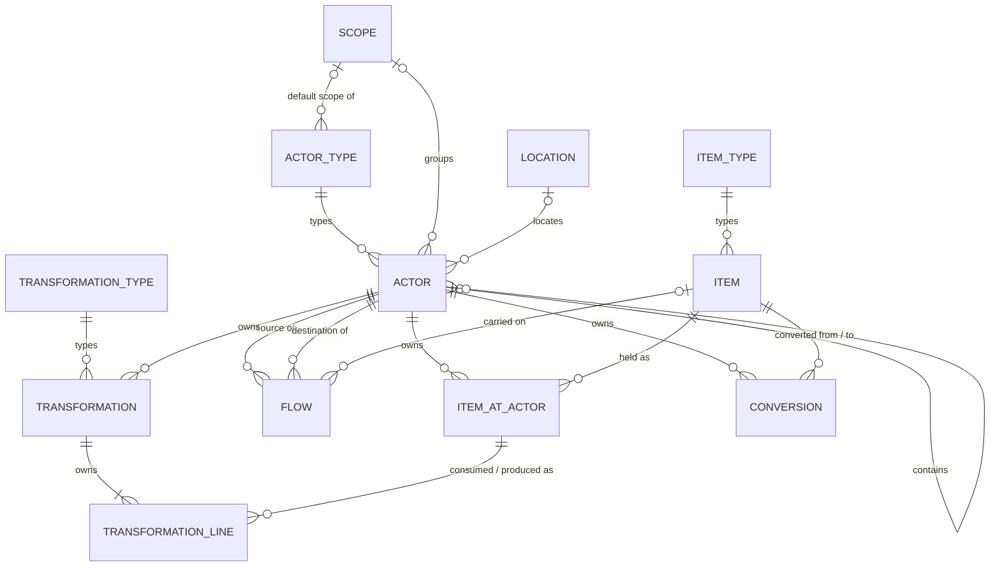

# The flow model

## Flow Network

*Concept.*

A **flow network** describes a supply chain through four entities: [items](#item) move between [actors](#actor) on [flows](#flow), and [transformations](#transformation) at an actor turn the items it consumes into the items it produces. An actor holds items; a flow carries items from one actor to another.

The same entities describe every [flow domain](#flow-domain) — a plant shipping products, an ERP system sending orders, a bank transferring payments, a service provider delivering interventions — so one network holds all four domains and the links between them, per [All Flow Domains](why-modelling-flows.md#all-flow-domains).

Every actor, flow and item has a [type](#typing) that gives it its business meaning. [Scopes](#scope) group actors into swim lanes.

A dataset describes one flow network: its actors, flows, items, transformations and scopes are instances of the dataset, and no instance stands for the network itself.

## Flow Domain

*Definition.*

A **flow domain** is the nature of what a flow network moves. It takes one of four values:

| Domain | What moves | What is held |
| --- | --- | --- |
| `physical` | Products, materials | Inventory |
| `information` | Messages, orders, invoices, data | Waiting queues |
| `financial` | Money, value | Cash, assets, liabilities, working capital |
| `service` | Service units | Work in progress, backlog |

The domain of an item is the domain of its type, and is exactly one; a flow has no domain. An actor's domains are the domains of its type, one or more: a plant is physical and information, a service provider is service and physical. The domain rules on [items at actors](#item-at-actor) and the [item of a flow](#flow) are stated with each of them.

## Actor

*Definition.*

An **actor** is a place in the network where items are held, consumed, produced or queued: a customer, a supplier, a plant, a production line, a warehouse, an ERP system, a planner, a bank, a service provider.

- Its `actor_type` is mandatory, can change, and gives its [domains](#flow-domain), one or more.
- It owns its [items at actor](#item-at-actor) — the items it holds — and its [transformations](#transformation).
- It can belong to one [scope](#scope), the swim lane that contains it. A new actor takes the default scope of its type when none is given, per [Actor Creation](implementation.md#actor-creation).
- It can be at one [location](#location), through its optional `location` relation, which can change. Several actors can share a location.
- It can be part of one parent actor, its optional `parent_actor`: a workshop in a plant. The relation is a composition, can change over time, and has `child_actors` as inverse. An actor's domains are among those of its parent, and the parents of an actor never lead back to it, per the network rules `parent_actor_domains` and `parent_actor_acyclic`.

## Flow

*Definition.*

A **flow** connects a source [actor](#actor) to a destination actor, and moves, transmits or delivers an item from the first to the second: a transportation lane, a communication link, a money wire, a service provision.

- `source` and `destination` are mandatory; the item moves from source to destination.
- Its `item` is optional: a flow carries at most one [item](#item). The actions set it once and never change or remove it.
- A flow between an actor and one of its child actors, in either direction, carries an item: it is a transport inside the actor (`internal_flow_item`).
- The item's domain is among the domains of the source and of the destination (`carried_item_domain`).
- Both ends hold the item through an [item at actor](#item-at-actor): what leaves the source and what reaches the destination is held there (`flow_ends_hold_item`).
- Its `bidirectional` flag is a boolean, `false` by default. When `true`, the item may move in both directions; when `false`, only from source to destination.
- Its `display_name` is optional. When given, it is a localized string with no uniqueness rule, so a flow is referenced by its id.

## Item

*Definition.*

An **item** is what the network moves and holds: a product, a material, a message, an order, an invoice, a currency, a service unit.

At [scoping granularity](why-modelling-flows.md#scoping-granularity), an item is a family — a product family, a message type, a service offering — and not an individual reference such as a SKU.

- Its `item_type` is mandatory, can change, and gives its [domain](#flow-domain), exactly one.
- It is defined once in the network and referenced by every [item at actor](#item-at-actor), [flow](#flow) and [transformation](#transformation) that involves it.

## Typing

*Concept.*

Every [actor](#actor), [item](#item) and [transformation](#transformation) has a type, instance of `actor_type`, `item_type` or `transformation_type` respectively. The type is mandatory and can change.

A type is data: an instance with a display name and a description, each in one or more languages, the description written for human and AI readers, per [Natural Language Capture](why-modelling-flows.md#natural-language-capture), and its [domains](#flow-domain) — exactly one for `item_type`, one or more for `actor_type`, none for `transformation_type`. Adding a type adds an instance and leaves the model unchanged, which is what [Typed Vocabulary](why-modelling-flows.md#typed-vocabulary) requires. A [flow](#flow) has neither a type nor a domain. A transformation has no domain either: the domain of each item it consumes or produces comes from that item.

An `actor_type` can name a `default_scope`: the [scope](#scope) given to an actor created with that type. It is optional, and an explicit scope overrides it.

Types and scopes are grouped in libraries. SCFLOW provides a base library for each domain; an industry vertical or a company provides its own library, which a network uses through CORE's `import`.

## Item At Actor

*Definition.*

An **item at actor** states that an [actor](#actor) holds an [item](#item): an inventory of products, a queue of orders, a cash balance, a backlog of service work.

- It is owned by its actor, and references its item; an actor holds a given item at most once.
- The item's domain is among the actor's domains.
- An item held by an actor cannot be deleted: the relation to the item is mandatory, so its deletion is restricted.

## Transformation

*Definition.*

A **transformation** states that an [actor](#actor) consumes items to produce other items: components assembled into a finished product, raw material processed into an intermediate, spare parts and technician hours turned into a maintenance intervention. It is the bill of materials (BOM) of the actor, generalized to every [domain](#flow-domain). It is an entity of the network in its own right, named like actors and flows.

- It is owned by its actor, where it takes place.
- Its `transformation_type` is mandatory and set at creation, like the type of an actor or an item, per [Typing](#typing); it carries no domain.
- Its lines list the consumed items and the produced items.
- Each line references the [item at actor](#item-at-actor) it consumes or produces, held by the transformation's own actor.
- Consumed and produced items can belong to different domains, as long as each is among the actor's domains — which is how a service built on products is described, per [All Flow Domains](why-modelling-flows.md#all-flow-domains).

Transformations are what link the flows reaching an actor to the flows leaving it.

## Conversion

*Definition.*

A **conversion** states that an [actor](#actor) turns one [item](#item) into another: a raw material into a part, a part into a finished product, a request into a quote. It is the one-to-one counterpart of a [transformation](#transformation), which consumes and produces several items, and is flow-like: it goes from an item to an item as a flow goes from an actor to an actor.

- It is owned by its actor, where it takes place.
- It references a source item (`from_item`) and a target item (`to_item`); both are mandatory and set at creation, and neither changes afterwards.
- The domain of the source item and the domain of the target item are identical.
- It has an optional display name and an optional description, each written in one or more languages.

An item referenced by a conversion cannot be deleted: the relation to the item is mandatory, so its deletion is restricted.

## Scope

*Definition.*

A **scope** groups [actors](#actor) into a swim lane read on its own: sourcing, production, distribution, a region, a business unit. In the graph a scope is a lane that contains its actors.

- A scope is flat: it has no parent and no owner. It is an instance of the dataset, and a type library holds scopes beside its types.
- An actor belongs to at most one scope, through its `scope` relation. An actor type can name a default scope, per [Typing](#typing).
- A flow connecting actors of different scopes crosses their boundary.

## Location

*Definition.*

A **location** is a geographic place or site where [actors](#actor) operate: a port, a plant site, a city, a customer address.

- A location is a root of the dataset, with no owner and no parent.
- An actor is at most at one location, through its optional `location` relation, which can change. The relation is declared on the actor: the location declares none, and `actors` is generated on it. Several actors can share one location.
- Its position is a `latitude` and a `longitude` in WGS84, in decimal degrees. They are filled in later when unknown, for example by geocoding. The engine gives an unset number the value 0, so a latitude and a longitude that are both 0 mean that the location has no coordinates: the point (0, 0) lies in the open sea, where no site stands.
- It carries an address (`address`, `postal_code`, `city`), a `country_code` (ISO 3166-1 alpha-2), a `un_locode` (UN/LOCODE, five characters) and a `timezone` (IANA name, such as `Europe/Paris`). All are optional, and an empty text means that the value is unset.

## Note

*Definition.*

A **note** is a free-form annotation on one entity of the network: an actor, a flow, an item, a scope, a type, an item at actor, a transformation, a transformation line or a conversion.

- A note has an id and a `content` in Markdown, in one or more languages.
- It belongs to exactly one annotated entity, through its `annotated` relation, and is deleted with that entity.
- An entity carries any number of notes, none by default, listed by its generated `notes` relation.
- Notes take no part in the network rules.

## Flow Model Overview

*Figure.*

## Domain Type Examples

*Example.*

Example types from the base libraries, by [domain](#flow-domain):

| Domain | Actor types | Item types |
| --- | --- | --- |
| `physical` | Customer, Supplier, Plant, Production line, Warehouse | Raw material, Component, Finished product |
| `information` | Organisation, Planner, ERP system, Customer portal | Message, Order, Invoice, Forecast |
| `financial` | Organisation, Bank, Financial institution | Currency, Value |
| `service` | Service provider, Technician, Resource | Service unit, Intervention |

An actor type spanning several domains appears in each of them: a Customer is physical, information and financial; a Service provider is service and physical.
