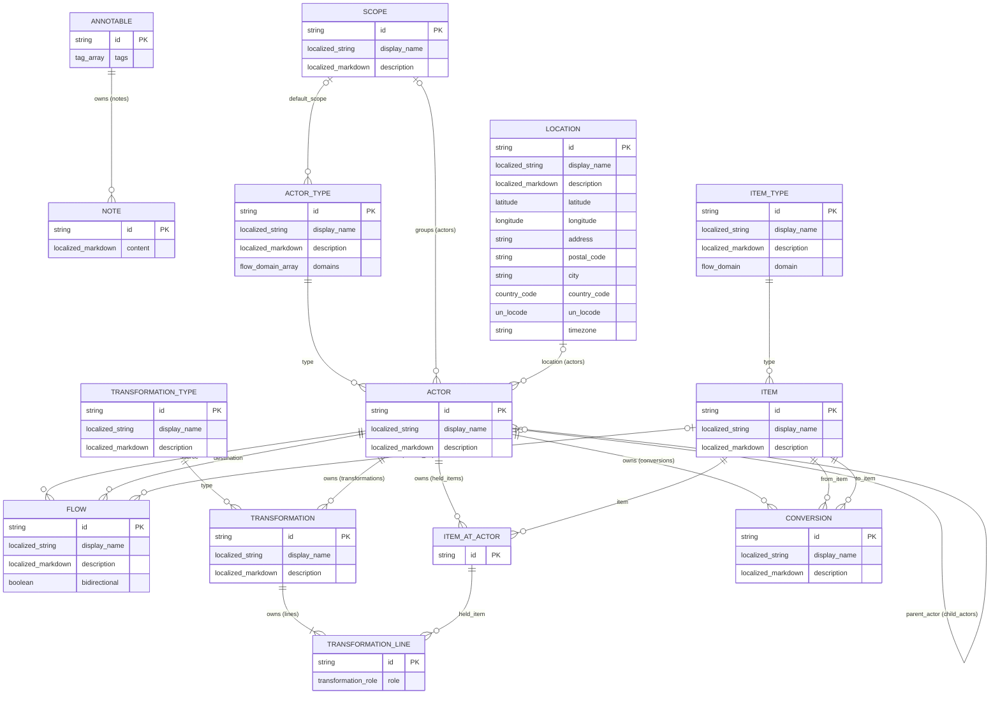

# The schemas

## Flow Model ER Diagram

*Figure.*



Every entity of the diagram extends `ANNOTABLE`, so it owns its notes and carries its tags.

## flow_domain

*Schema.*

```yaml
name: flow_domain
extends: string
enum: [physical, information, financial, service]
```

The values of a [Flow Domain](flow-model.md#flow-domain), used by `actor_type` and `item_type`.

## transformation_role

*Schema.*

```yaml
name: transformation_role
extends: string
enum: [consumed, produced]
```

The role of a `transformation_line` in its [Transformation](flow-model.md#transformation): the item is consumed or produced.

## tag

*Schema.*

```yaml
name: tag
extends: string
```

A free-form label that every entity carries in its `tags`, declared once on [annotable](#annotable). A tag has no constraint: any string is valid, and the model does not restrict the values. The entries of a `tags` array are distinct: a `create` or an `update` that holds the same tag twice is refused with `constraint_violation`. Tags are compared as written, so `North` and `north` are two tags.

## latitude

*Schema.*

```yaml
name: latitude
extends: number
minimum: -90
maximum: 90
```

The latitude of a [location](flow-model.md#location), in decimal degrees. A value of 0 with a longitude of 0 means that the coordinates are unset, per [Location](flow-model.md#location).

## longitude

*Schema.*

```yaml
name: longitude
extends: number
minimum: -180
maximum: 180
```

The longitude of a [location](flow-model.md#location), in decimal degrees. A value of 0 with a latitude of 0 means that the coordinates are unset, per [Location](flow-model.md#location).

## country_code

*Schema.*

```yaml
name: country_code
extends: string
pattern: ^([A-Z]{2})?$
```

Two uppercase letters, such as `FR`, `DE`, `US` or `CN`, or the empty text when the country is unset: the engine gives an omitted text the empty value, which the pattern must accept. The model checks the format, not that the code is assigned.

## un_locode

*Schema.*

```yaml
name: un_locode
extends: string
pattern: ^([A-Z]{2}[A-Z2-9]{3})?$
```

The country code followed by three characters, such as `FRLEH` for Le Havre or `NLRTM` for Rotterdam, or the empty text when the code is unset. The model checks the format, not that the code exists.

## Write actions

*Rule.*

Each schema names the business action that takes the place of a generated CRUD operation in its `crud` constraint (see Action in the [meta-model](../../../core/docs/spec/meta-model.md#action)). An operation that is not listed is generated. The schema `location` lists none. `annotable` is `abstract`, because every instance belongs to a concrete schema, so no action is generated for it.

| Schema | Create | Update | Delete |
| --- | --- | --- | --- |
| `note` | `scflow/add_note` | `scflow/update_note` | `scflow/remove_note` |
| `actor_type` | `scflow/create_actor_type` | generated | `scflow/delete_actor_type` |
| `item_type` | `scflow/create_item_type` | generated | `scflow/delete_item_type` |
| `actor` | `scflow/create_actor` | `scflow/update_actor` | `scflow/delete_actor` |
| `flow` | `scflow/create_flow` | `scflow/update_flow` | `scflow/delete_flow` |
| `item` | `scflow/create_item` | `scflow/update_item` | `scflow/delete_item` |
| `item_at_actor` | `scflow/hold_item` | generated | `scflow/release_held_item` |
| `transformation_type` | `scflow/create_transformation_type` | generated | `scflow/delete_transformation_type` |
| `transformation` | `scflow/create_transformation` | generated | `scflow/delete_transformation` |
| `transformation_line` | `scflow/connect_transformation_line` | generated | generated |
| `conversion` | `scflow/create_conversion` | `scflow/update_conversion` | `scflow/delete_conversion` |
| `scope` | `scflow/create_scope` | generated | `scflow/delete_scope` |

The `item` of a `flow` is `updated_by` `scflow/set_flow_item`, because the item of a flow is set once and never changes.

## annotable

*Schema.*

```yaml
name: annotable
description: The base schema of every entity that carries notes and tags
is_root:
properties:
  - name: tags
    type: tag
    is_array:
    is_unique:
```

Every schema of this section extends `annotable`. `notes` is generated from the `annotated` relation of `note`, so any instance lists its [notes](flow-model.md#note). `tags` is declared here once, so any instance carries its [tags](#tag): an array, empty by default, whose entries are distinct. A schema keeps its own ownership: `actor` is a root and `transformation` is owned by its actor. Deleting an instance deletes its notes.

## note

*Schema.*

```yaml
name: note
description: A free-form annotation of one entity, written in one or more languages
properties:
  - name: annotated
    type: annotable
    owner:
    inverse_name: notes
    inverse_is_array:
  - name: content
    type: localized_markdown
    min_length: 1
```

Per [Note](flow-model.md#note). Shared with an id key. The owner of a note is the annotated instance, whatever its schema.

## actor_type

*Schema.*

```yaml
name: actor_type
extends: annotable
description: A type of actor, with the flow domains it belongs to
is_root:
has_description:
properties:
  - name: display_name
    type: localized_string
    min_length: 1
  - name: description
    type: localized_markdown
  - name: domains
    type: flow_domain
    is_set:
    min_length: 1
  - name: default_scope
    type: scope
```

Per [Typing](flow-model.md#typing). `domains` is a set of `flow_domain`: its values are distinct and their order carries no meaning. `default_scope` is the scope given to an actor created with this type, per [Actor Creation](implementation.md#actor-creation); it is optional and has no inverse relation. `actors` is generated from `actor`'s `type` relation.

## item_type

*Schema.*

```yaml
name: item_type
extends: annotable
description: A type of item, with the one flow domain it belongs to
is_root:
has_description:
properties:
  - name: display_name
    type: localized_string
    min_length: 1
  - name: description
    type: localized_markdown
  - name: domain
    type: flow_domain
```

Per [Typing](flow-model.md#typing). `items` is generated from `item`'s `type` relation.

## actor

*Schema.*

```yaml
name: actor
extends: annotable
description: A place in the network where items are held, consumed, produced or queued
is_root:
properties:
  - name: display_name
    type: localized_string
    min_length: 1
  - name: description
    type: localized_markdown
  - name: type
    type: actor_type
    mandatory:
    inverse_name: actors
    inverse_is_array:
  - name: scope
    type: scope
    inverse_name: actors
    inverse_is_array:
  - name: location
    type: location
    inverse_name: actors
    inverse_is_array:
  - name: parent_actor
    type: actor
    inverse_name: child_actors
    inverse_is_array:
```

Per [Actor](flow-model.md#actor). Generated relations: `outgoing_flows` and `incoming_flows` from `flow`, `held_items` from `item_at_actor`, `transformations` from `transformation`, `child_actors` from `actor`'s `parent_actor`. `location` is optional and can change; several actors can share one location, and the `location` schema declares no relation to actors. `parent_actor` is optional and can change; the network rules `parent_actor_domains` and `parent_actor_acyclic` constrain it.

## flow

*Schema.*

```yaml
name: flow
extends: annotable
description: A connection moving one optional item from a source actor to a destination actor
is_root:
properties:
  - name: display_name
    type: localized_string
  - name: description
    type: localized_markdown
  - name: source
    type: actor
    mandatory:
    inverse_name: outgoing_flows
    inverse_is_array:
  - name: destination
    type: actor
    mandatory:
    inverse_name: incoming_flows
    inverse_is_array:
  - name: item
    type: item
    inverse_name: carried_on
    inverse_is_array:
  - name: bidirectional
    type: boolean
```

Per [Flow](flow-model.md#flow). `display_name` and `item` are optional. `item` carries no `constant` constraint, which would forbid setting it after creation: the actions set it once and refuse any later change.

## item

*Schema.*

```yaml
name: item
extends: annotable
description: A family of things the network moves and holds
is_root:
properties:
  - name: display_name
    type: localized_string
    min_length: 1
  - name: description
    type: localized_markdown
  - name: type
    type: item_type
    mandatory:
    inverse_name: items
    inverse_is_array:
```

Per [Item](flow-model.md#item). Generated relations: `held_at` from `item_at_actor`, `carried_on` from the `item` of `flow`.

## item_at_actor

*Schema.*

```yaml
name: item_at_actor
extends: annotable
description: An item held at an actor
properties:
  - name: actor
    type: actor
    owner:
    inverse_name: held_items
    inverse_is_array:
  - name: item
    type: item
    mandatory:
    constant:
    inverse_name: held_at
    inverse_is_array:
```

Per [Item At Actor](flow-model.md#item-at-actor). Shared with an id key. `transformation_lines` is generated from `transformation_line`.

## transformation_type

*Schema.*

```yaml
name: transformation_type
extends: annotable
description: A type of transformation
is_root:
has_description:
properties:
  - name: display_name
    type: localized_string
    min_length: 1
  - name: description
    type: localized_markdown
```

Per [Typing](flow-model.md#typing). It has no domain: the domain of the items a transformation consumes or produces comes from the items themselves. `transformations` is generated from `transformation`'s `type` relation.

## transformation

*Schema.*

```yaml
name: transformation
extends: annotable
description: A transformation of consumed items into produced items at an actor
properties:
  - name: display_name
    type: localized_string
    min_length: 1
  - name: description
    type: localized_markdown
  - name: type
    type: transformation_type
    mandatory:
    constant:
    inverse_name: transformations
    inverse_is_array:
  - name: actor
    type: actor
    owner:
    inverse_name: transformations
    inverse_is_array:
```

Per [Transformation](flow-model.md#transformation). `lines` is generated from `transformation_line`. `type` is per [Typing](flow-model.md#typing).

## transformation_line

*Schema.*

```yaml
name: transformation_line
extends: annotable
description: One item consumed or produced by a transformation
properties:
  - name: transformation
    type: transformation
    owner:
    inverse_name: lines
    inverse_is_array:
  - name: role
    type: transformation_role
  - name: held_item
    type: item_at_actor
    mandatory:
    inverse_name: transformation_lines
    inverse_is_array:
```

Per [Transformation](flow-model.md#transformation). Shared with an id key. `held_item` references the item at actor of the transformation's own actor.

## conversion

*Schema.*

```yaml
name: conversion
extends: annotable
description: A conversion of one item into another item at an actor
properties:
  - name: display_name
    type: localized_string
  - name: description
    type: localized_markdown
  - name: actor
    type: actor
    owner:
    inverse_name: conversions
    inverse_is_array:
  - name: from_item
    type: item
    mandatory:
    constant:
  - name: to_item
    type: item
    mandatory:
    constant:
```

Per [Conversion](flow-model.md#conversion). `from_item` and `to_item` have no inverse relation. The identical domains of the two items are the rule `conversion_item_domain` of [Network Rules](implementation.md#network-rules).

## scope

*Schema.*

```yaml
name: scope
extends: annotable
description: A flat grouping of actors, a swim lane of the graph
is_root:
properties:
  - name: display_name
    type: localized_string
    min_length: 1
  - name: description
    type: localized_markdown
```

Per [Scope](flow-model.md#scope). A scope has no owner and no parent, so a type library holds scopes beside its types. `actors` is generated from `actor`'s `scope` relation. The `default_scope` relation of `actor_type` has no inverse.

## location

*Schema.*

```yaml
name: location
extends: annotable
description: A geographic place or site where actors operate
is_root:
properties:
  - name: display_name
    type: localized_string
    min_length: 1
  - name: description
    type: localized_markdown
  - name: latitude
    type: latitude
  - name: longitude
    type: longitude
  - name: address
    type: string
  - name: postal_code
    type: string
  - name: city
    type: string
  - name: country_code
    type: country_code
  - name: un_locode
    type: un_locode
  - name: timezone
    type: string
```

Per [Location](flow-model.md#location). Every property but `display_name` is optional: an unset number is 0 and an unset text is empty, so both coordinates at 0 mean no coordinates. A location has no owner, so a type library holds locations beside its types. `actors` is generated from `actor`'s `location` relation. `timezone` holds an IANA name; the model does not check it.
